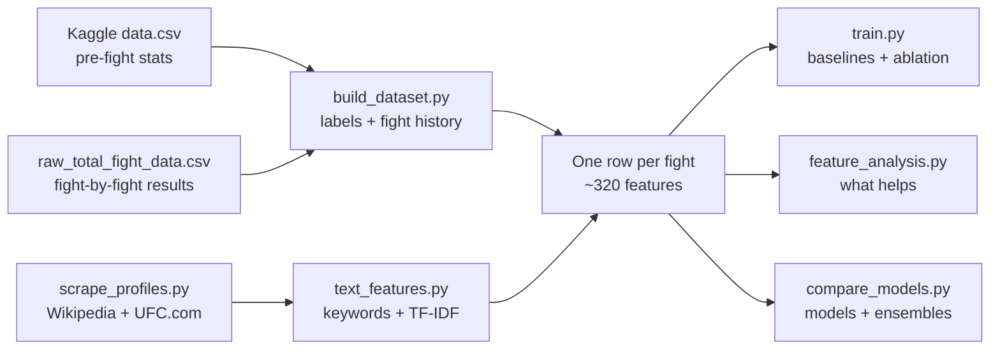

# Predicting UFC Method of Victory with Multimodal Machine Learning

**Group 4:** Ryan Rassoli, Samuel Balogun, Shourya Sai Macha, Andrew Amadasu
**Course:** Intro to AI & Machine Learning, Final Project

Before a UFC fight starts, can we predict **how it will end**: knockout (KO/TKO), submission, or judges' decision? This project combines three kinds of data about the two fighters (stats, recent fight history, and written profiles) and uses only information that was available **before** each fight.

**Best result:** an average of CatBoost, LightGBM and XGBoost reaches **0.454 macro F1** on 2020–21 fights, about double the 0.22 of always guessing "Decision."

---

## Contents

1. [The problem](#1-the-problem)
2. [Data and modalities](#2-data-and-modalities)
3. [Pipeline and how to run it](#3-pipeline-and-how-to-run-it)
4. [Features: what helped and what didn't](#4-features-what-helped-and-what-didnt)
5. [Models and evaluation](#5-models-and-evaluation)
6. [Leakage control](#6-leakage-control)
7. [Project journey: what worked, what didn't, what we changed](#7-project-journey-what-worked-what-didnt-what-we-changed)
8. [Personal test set](#8-personal-test-set)
9. [Repository layout](#9-repository-layout)
10. [Limitations and next steps](#10-limitations-and-next-steps)
11. [Milestone presentations](#11-milestone-presentations)
12. [Data sources](#12-data-sources)

---

## 1. The problem

**Task:** a 3-class prediction of how a fight ends: `KO/TKO`, `SUB` (submission) or `DEC` (decision).

**Why it's hard:** MMA has a lot of luck in it (one punch, a cut, a close split decision). Even betting favorites, who have far more information than any dataset, win only about two-thirds of UFC fights, and odds are weaker still at predicting *how* a fight ends. So the goal isn't perfect accuracy. It's to beat simple baselines and learn which kinds of data carry signal.

**Metric:** **macro F1**, the average F1 score across the three classes. About half of recent fights go to decision, so a model that always says "Decision" would get about 50% accuracy while learning nothing. Macro F1 scores that model at 0.22.

## 2. Data and modalities

| Modality | Source | Features | Coverage |
|---|---|---|---|
| **Tabular**: pre-fight stats | Kaggle [rajeevw/ufcdata](https://www.kaggle.com/datasets/rajeevw/ufcdata) `data.csv` | Height, reach, weight, age, stance; per-fight averages of strikes, takedowns, submission attempts, control time; opponents' averages; win/loss record | All fights (blank for UFC debuts) |
| **Time-series**: recent form | Same dataset, `raw_total_fight_data.csv` | Each fighter's last 5 fights: win rate, wins by KO/sub/decision, losses by KO/sub, finish rate, rounds per fight, days since last fight | All fights |
| **Text**: fighter profiles | Wikipedia + UFC.com athlete pages | Martial arts keyword flags (wrestling, BJJ, judo, sambo, boxing, Muay Thai…), a 16-number TF-IDF summary, profile length | 97% of fighters |

**Labels:** `win_by` from `raw_total_fight_data.csv`, grouped into KO/TKO (incl. doctor stoppage), Submission, and Decision (unanimous, split, majority). The two Kaggle files list the same 6,012 fights in the same order, so the join is exact.

**After cleaning:** 5,884 fights (1994 to March 2021): 46% Decision, 34% KO/TKO, 21% Submission. We dropped 128 draws, no-contests, DQs and overturned results.

**How the modalities line up:** stats and history share fighter names and fight dates; text joins on fighter name. Each fight becomes one row with features for both corners plus matchup differences (e.g., reach gap).

## 3. Pipeline and how to run it



```bash
pip install -r requirements.txt

python build_dataset.py      # join labels, build fight-history features -> data/fights.csv
python train.py              # baselines + modality ablation           -> results/ablation.csv
python train.py --era        # also rerun the training-start-year test  -> results/era_experiment.csv
python feature_analysis.py   # feature-family importance + pruning      -> results/family_importance.csv
python compare_models.py     # 9 models, fusion types, ensembles        -> results/model_comparison.csv
```

The text profiles are already saved in `data/fighter_profiles.csv`. To rebuild them (needs internet, about 1 hour; resumes if interrupted):

```bash
python scrape_profiles.py --data data/data.csv --since 2010 --extra personal_test_set/meta.csv
python embed_profiles.py     # optional: MiniLM sentence embeddings (downloads a ~90 MB model)
```

## 4. Features: what helped and what didn't

To answer "what actually matters," we grouped the 321 features into 13 families. We then shuffled one family at a time on the 2019 validation set and measured how much macro F1 dropped (permutation importance, averaged over 10 shuffles). A big drop means the model relies on that family.

| Feature family | # features | F1 drop when shuffled | Verdict |
|---|---|---|---|
| Physical: height, reach, weight, age | 12 | 0.037 | Most useful |
| Text: TF-IDF word summary | 32 | 0.028 | Useful |
| Opponent stats (what opponents did to them) | 72 | 0.025 | Useful |
| History: recent form & activity | 15 | 0.017 | Useful |
| Record: wins, losses, streaks, win methods | 27 | 0.011 | Small help |
| Grappling averages | 30 | 0.009 | Small help |
| Context: weight class, rounds, title | 16 | 0.008 | Small help |
| Striking averages | 42 | 0.007 | Small help (noisy) |
| Physical: stance | 15 | 0.002 | About irrelevant |
| History: how recent fights ended | 18 | 0.002 | About irrelevant |
| Text: martial arts keywords | 33 | 0.000 | Irrelevant (the TF-IDF already captures it) |
| Debut flags | 4 | 0.000 | Irrelevant |
| Text: profile exists / length | 5 | −0.002 | Irrelevant |

- **21 features were never used by any tree**, mostly stance, rare weight classes and rare keywords.
- **Removing the weak families didn't clearly help:** validation went 0.451 → 0.439 while test went 0.432 → 0.451. We choose on validation, so we kept all features. This also shows the run-to-run noise is about ±0.02.
- **A caution about TF-IDF:** it may partly work as a fingerprint for individual fighters (gym names, hometowns) rather than describing fighting style.

Details: `results/family_importance.csv`, `results/feature_importance_all.csv`, `results/pruning.csv`.

## 5. Models and evaluation

**Split by date**, so the model never learns from the future: train on 2010–2018 (3,601 fights), validate on 2019 (505), test on 2020–21 (554). Every choice (tuning, ensemble members, class weights) is made on 2019. The test years are scored once.

**Modality ablation** (XGBoost, averaged over 5 seeds):

| Model | Val 2019 | Test 2020–21 |
|---|---|---|
| All three modalities | 0.45 | 0.43 |
| Drop text | 0.43 | 0.43 |
| Drop history | 0.44 | 0.43 |
| Drop tabular | 0.42 | 0.43 |
| Text only | 0.39 | 0.39 |
| Context only (weight class, rounds, title) | 0.33 | 0.38 |
| Logistic regression (stats only) | 0.39 | 0.40 |
| Majority class | 0.23 | 0.22 |

Each modality adds about 0.01, and no single one carries the model. Text helps most on submissions (F1 0.25 → 0.29), but its overall gain is not statistically significant: a paired bootstrap gives +0.010 (95% interval −0.011 to +0.032).

**Model comparison** (all three modalities):

| Model | Val 2019 | Test 2020–21 |
|---|---|---|
| **CatBoost + LightGBM + XGBoost, averaged** | **0.457** | **0.454** |
| CatBoost | 0.457 | 0.432 |
| XGBoost | 0.451 | 0.432 |
| LightGBM | 0.451 | 0.431 |
| XGBoost, grid-tuned on 2019 | 0.443 | 0.441 |
| Late fusion: one model per modality, averaged | 0.414 | 0.443 |
| Random forest / Extra trees | 0.415 / 0.414 | 0.425 / 0.428 |
| HistGradientBoosting | 0.412 | 0.401 |
| Logistic regression | 0.406 | 0.407 |
| Late fusion: stacked combiner | 0.403 | 0.422 |
| Neural net (MLP) | 0.397 | 0.451 |

- **The three-model ensemble is our final model.** It's +0.022 over XGBoost alone, and that gain is statistically significant (bootstrap 95% interval +0.006 to +0.040). It improved decisions (F1 0.58 → 0.60) and KOs (0.44 → 0.48); submissions barely changed.
- **Early fusion beat late fusion.** The modalities work better when one model sees them together.
- **Tuning on validation overfit.** Grid search and class-weight adjustments looked better on 2019 but not on 2020–21.
- **The neural net is unstable:** worst on validation, good on test. We wouldn't pick it.

**Where it fails:** on the 2020–21 test set, the final ensemble correctly identifies 59% of decisions (167 of 281) and 48% of KOs (85 of 178), but only 29% of submissions (28 of 95). More than half of real submissions (51 of 95) are predicted as decisions.

## 6. Leakage control

Leakage means accidentally giving the model information it couldn't have before the fight. We found and fixed several cases.

- **Stats:** `data.csv` averages only fights *before* each bout (checked: a fighter's UFC debut shows 0–0 and blank averages). Outcome columns such as `last_round` and the winner are never used as features.
- **Text:** profiles are written today, so they describe the future relative to most fights. The filter in `scrape_profiles.py` keeps only background/style sections and drops any sentence about:
  - results, rounds, records, titles, UFC event numbers
  - signings, releases, other promotions, later careers, retirement, death
  - rankings, awards and hindsight summaries ("#1 lightweight of all time," "Fight of the Year")
  - suspensions, legal trouble, family life
  - any date from 2005 on
- **Wrong pages:** 7 Wikipedia "may refer to" pages (several people with the same name) are dropped.
- **Splitting and tuning:** the split is by date, and all choices are made on 2019 only.

## 7. Project journey: what worked, what didn't, what we changed

### Proposal
- **Plan:** predict method of victory from fighter stats (tabular) plus written fighter profiles (text). Metric: macro F1.

### Milestone 1 (Nov 11)
- **Feedback: "not enough data."** The text modality was only an idea, so in practice the project had one data type.

### Between Milestones 1 and 2

| Step | What we tried | Result | Decision |
|---|---|---|---|
| 1 | Verified the Kaggle files and label join | Same 6,012 fights in the same order; stats are pre-fight | Use `data.csv` + `win_by` |
| 2 | Added a **fight-history** modality from data we already had | Small, consistent gain | Keep as the 3rd modality |
| 3 | Dropped the rare "Other" class (DQs, overturned) | Too few examples to learn | Predict 3 classes |
| 4 | First baseline: XGBoost on stats + history, trained on 1994–2018 | 0.42 test (one seed) vs 0.22 majority | Starting point |
| 5 | **Era check:** decisions rose from 24% of fights (pre-2005) to 51% (2020–21) | Training from 2010 instead of 1994: 0.40 → 0.43 (5 seeds) | Train on 2010+ only |
| 6 | **Debut flag** for the 28% of fights with a first-time fighter | 0.428 vs 0.427, no effect | Kept (harmless); XGBoost already learns from missing values |
| 7 | Averaged every model over **5 random seeds** | Single runs varied by about ±0.01 | Report seed averages |
| 8 | **Text scraper**, 20-fighter test run | Found leaks: career-end dates, retirement, death dates, family life | Added the first leak filter; skip "Personal life" |
| 9 | Full scrape: **1,695 fighters, 97% coverage** | Found "has never been to a decision," UFC event numbers, later contracts, prison | Stricter filter (results, rounds, events, signings, dates from 2005 on) |
| 10 | Checked for wrong pages | 7 "may refer to" pages | Drop them |
| 11 | Added text to the model | 0.43 → 0.44 test, 0.43 → 0.45 val | Keep text |
| 12 | Built a real example slide (Khabib vs. Gaethje) | Found hindsight lines: "#1 lightweight of all time," "Fight of the Year" | Hindsight filter; text-only fell 0.41 → 0.39 (some earlier signal was leakage) |
| 13 | **Bootstrap test** of the text gain | +0.010, 95% interval −0.011 to +0.032 | Report text as "promising, not proven" |

### Milestone 2 (Nov 18)
- Presented three modalities, the ablation (0.43 test), data findings and the leakage story.
- **Feedback:** show more about which features and data helped or were irrelevant, and what we dropped; try other models and combinations to improve the score.

### After Milestone 2

| Step | What we tried | Result | Decision |
|---|---|---|---|
| 14 | **Feature-family permutation importance** | Physical, TF-IDF text, opponent stats and recent form matter most; keywords, stance, debut flags don't | Documented (section 4) |
| 15 | **Pruning** weak families | Val down 0.012, test up 0.019 | Inconclusive: keep all features |
| 16 | **Compared 9 models** | CatBoost/LightGBM/XGBoost lead; logistic regression and HistGB trail | Boosted trees are the best family |
| 17 | **Late fusion** (per-modality models) | Worse on validation than early fusion | Keep early fusion |
| 18 | **Grid-tuned XGBoost, class-weight tuning** | Better on val, not on test | Don't over-tune on 2019 |
| 19 | **Ensemble** of the top 3 (chosen on 2019) | **0.454 test**, +0.022, statistically significant | **Final model** |

## 8. Personal test set

20 real fights from **UFC 317** (June 28, 2025) and **UFC 320** (Oct 4, 2025), four years past the training data: 7 KO/TKO, 6 Submission, 7 Decision. Debut fights were skipped (no stats to use).

| File | Contents |
|---|---|
| `personal_test_set/meta.csv` | Model inputs. Fighters are listed alphabetically so the order never reveals the winner |
| `personal_test_set/labels.csv` | The answer key, kept separate |
| `personal_test_set/README.md` | How fights were chosen; consent notes |

All 40 fighters have text profiles. Still to collect: each fighter's stats as of the day before their fight, rebuilt from UFCStats fight logs the same way as the training data.

## 9. Repository layout

```
├── build_dataset.py        # labels + fight-history features
├── text_features.py        # text -> keyword flags + TF-IDF
├── train.py                # date split, baselines, XGBoost, modality ablation
├── feature_analysis.py     # permutation importance by feature family, pruning test
├── compare_models.py       # 9 models, early vs late fusion, ensembles
├── scrape_profiles.py      # Wikipedia + UFC.com profiles with leak filter
├── embed_profiles.py       # optional MiniLM embeddings
├── data/                   # Kaggle CSVs + fighter_profiles.csv
├── personal_test_set/      # 20 fights from 2025
├── results/                # every result table in this README
└── presentations/          # milestone slide decks
```

## 10. Limitations and next steps

- **Submissions are hard to predict.** Only about 29% are caught.
- **Era gap:** the training data ends in March 2021, and the sport keeps changing.
- **Small personal test set:** 20 fights give noisy scores, so errors will be analyzed fight by fight.
- **The text signal is modest** and may partly identify fighters rather than describe style.
- **Not yet run:** MiniLM embeddings (`embed_profiles.py`).

**For the final:** collect personal-set stats and run the final model on them; compare public vs personal results; build `predict_multimodal()` and the upload/run harness.

## 11. Milestone presentations

Slide decks for each milestone are in [`presentations/`](presentations/).

## 12. Data sources

- **Kaggle:** [UFC-Fight historical data 1993–2021](https://www.kaggle.com/datasets/rajeevw/ufcdata) (rajeevw): `data.csv`, `raw_total_fight_data.csv`, `raw_fighter_details.csv`
- **Wikipedia** (CC BY-SA) and **UFC.com** athlete pages: fighter profile text in `data/fighter_profiles.csv`, collected for class use
- **Personal test set results:** UFC 317 and UFC 320 results pages
